<p align="center">
  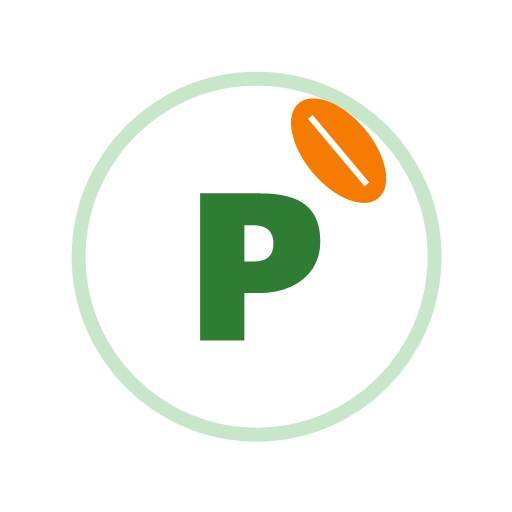
</p>

<h1 align="center">Pratin</h1>

<p align="center"><em>Alimento bom não se joga fora.</em></p>

<p align="center">
  App mobile em Flutter que conecta padarias, mercados e restaurantes a ONGs
  para doar alimentos próximos do vencimento.
</p>

---

## Desenvolvedores

| RM | Nome completo |
| --- | --- |
| RM555350 | Frederico Nakayama Sant'anna |
| RM556199 | João Pedro Veloso Pilon |

---
### Link do Github: https://github.com/FredericoNakayama/Pratin---Flutter---3SIS_GS2026

---

## Tema da Global Solution: CitizenTech

O tema pede para identificar um problema real que afete a vida das pessoas e criar uma solução tecnológica que gere uma melhoria concreta, partindo da necessidade humana.

| Pergunta | Resposta do Pratin |
| --- | --- |
| **Qual é o problema real?** | Alimentos ainda próprios para consumo vão para o lixo por estarem perto do vencimento, enquanto famílias do mesmo bairro passam fome. |
| **Quem convive com ele?** | Pessoas em insegurança alimentar atendidas por ONGs; voluntários de ONGs que buscam doações; pequenos empreendedores que perdem mercadoria e não têm um canal simples para doar. |
| **Território** | Bairros de metrópoles e de cidades pequenas, onde o comércio e a ONG estão próximos mas não se conectam. |
| **Melhoria concreta** | Doar leva poucos toques; a retirada é organizada com código e horário; menos desperdício e mais refeições para quem precisa. |
| **Como medir o impacto** | Lotes retirados, quantidade redistribuída e tempo entre o anúncio e a reserva (dados disponíveis na API). |

O Pratin se relaciona com os ODS 2 (Fome zero) e 12 (Consumo e produção responsáveis).

---

## Descrição da solução

1. O **estabelecimento** anuncia um lote de alimento próprio para consumo, com validade de até 7 dias e uma janela de retirada.
2. A **ONG** encontra o lote no app, reserva e recebe um **código de retirada** de 6 caracteres.
3. Na retirada, o estabelecimento digita o código e a doação é concluída.

A doação é **sempre gratuita**. Não há login: o usuário escolhe o perfil (Estabelecimento ou ONG) e o CNPJ identifica o dono dos anúncios e das reservas.

| Perfil | O que faz |
| --- | --- |
| Estabelecimento | Anuncia alimentos, acompanha e cancela anúncios, confirma a retirada pelo código |
| ONG | Consulta, favorita e reserva alimentos, recebe o código e cancela reservas |
| Sem perfil | Consulta a lista; para anunciar ou reservar, o app pede que configure o perfil |

**Ciclo de vida de um alimento**

```
DISPONÍVEL ──ONG reserva──► RESERVADO ──código confirmado──► RETIRADO
    │  ▲                       │
    │  └──ONG cancela reserva──┘
    │                          └──janela encerrada──► EXPIRADO
    ├──estabelecimento cancela──► CANCELADO
    └──janela encerrada──► EXPIRADO
```

---

## Fluxo de telas

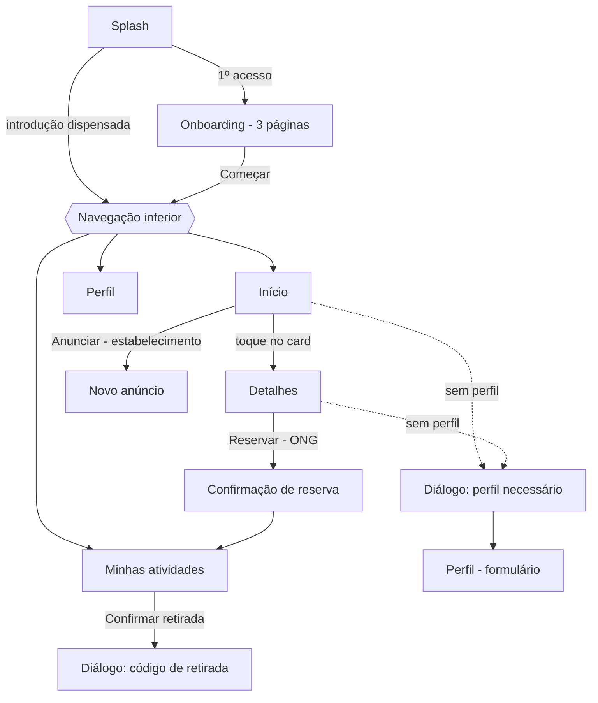

**Telas principais (além de Splash e Onboarding):** Início, Detalhes, Novo anúncio, Confirmação de reserva, Minhas atividades e Perfil.

---

## Prints das telas

| Splash | Onboarding | Introdução: última página |
| :---: | :---: | :---: |
| 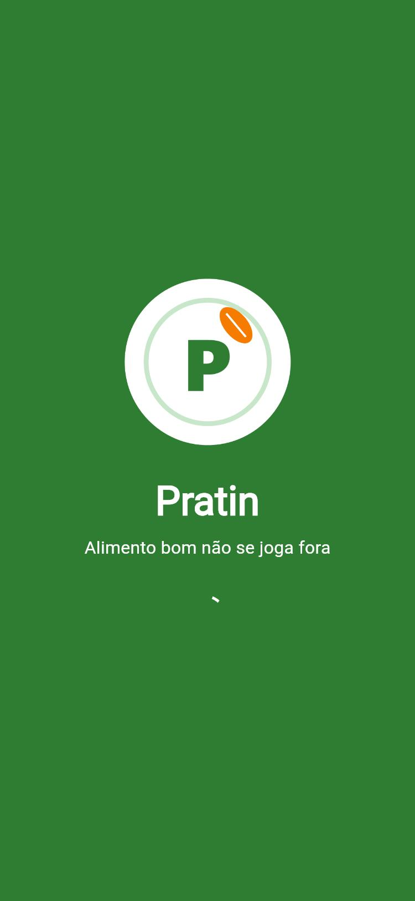 | 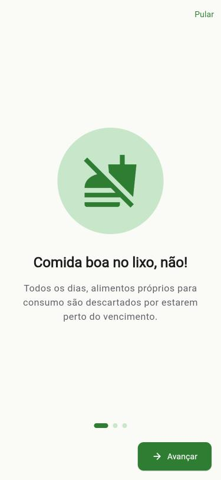 | 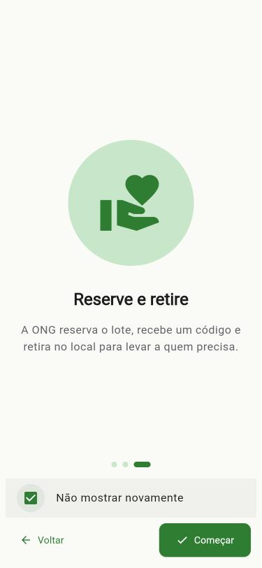 |

| Início | Detalhes | Perfil necessário |
| :---: | :---: | :---: |
| 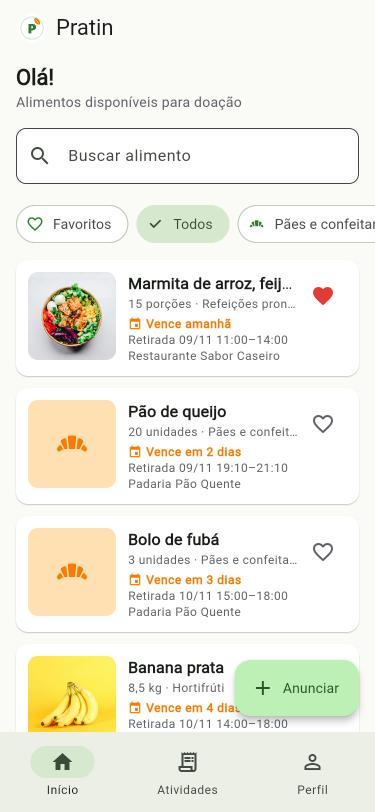 | 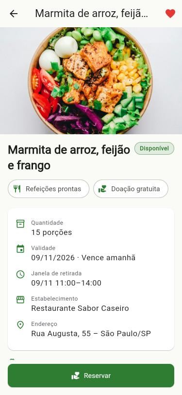 | 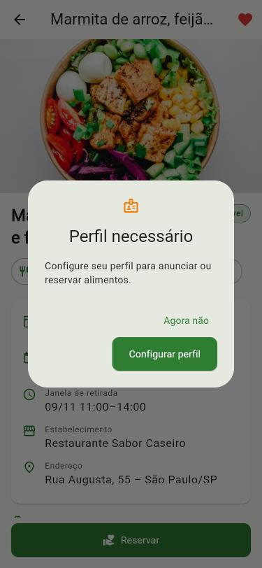 |

| Configurar perfil | Reserva confirmada | Minhas reservas (ONG) |
| :---: | :---: | :---: |
| 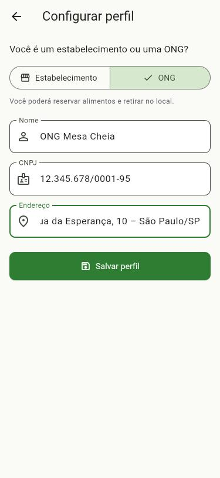 | 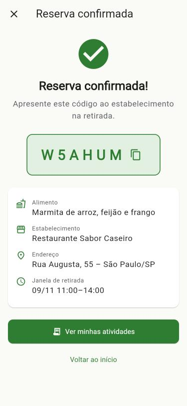 | 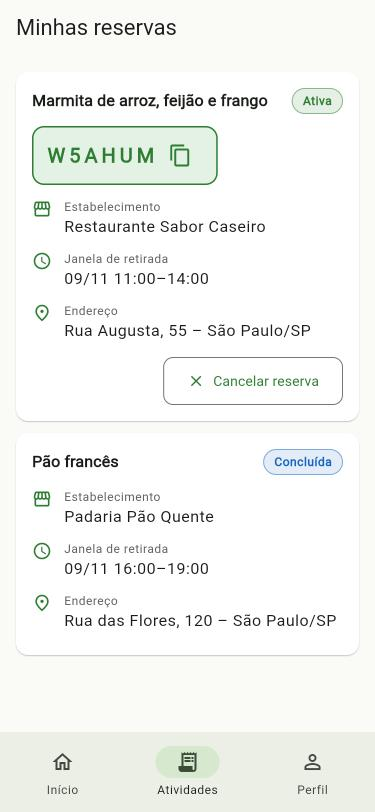 |

| Meu perfil | Meus anúncios (estabelecimento) | Confirmar retirada |
| :---: | :---: | :---: |
| 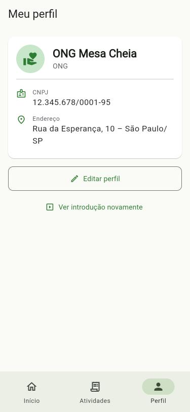 | 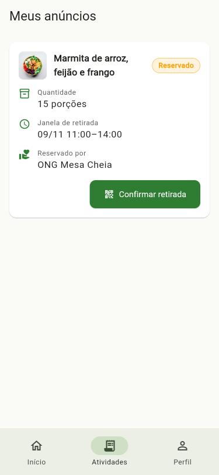 | 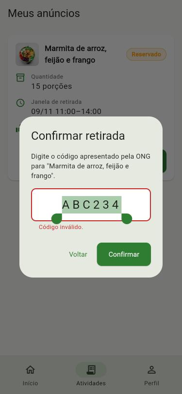 |

| Novo anúncio (foto pela galeria, câmera ou URL) | Seletor de data | Grade em tablet |
| :---: | :---: | :---: |
| 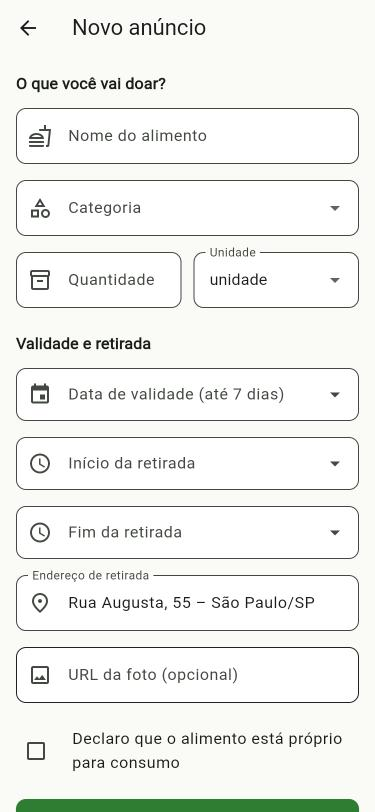 | 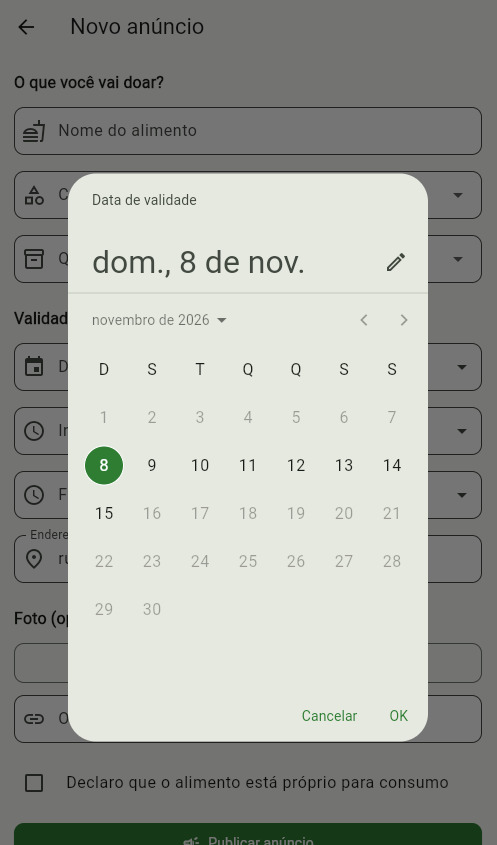 | 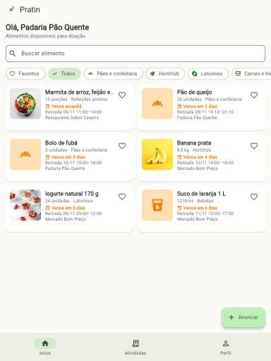 |

---

## API utilizada

API REST simulada no **[MockAPI](https://mockapi.io)**, consumida com o pacote `http`.

**Base URL:** `https://6af0e42d11a6aa866e7fd061.mockapi.io/api/v1`

| Método | Endpoint | Uso |
| --- | --- | --- |
| GET | `/alimentos?status=DISPONIVEL` | Lista do Início |
| GET | `/alimentos?estabelecimentoCnpj={cnpj}` | Anúncios do estabelecimento |
| GET | `/alimentos/{id}` | Nova consulta antes de reservar |
| POST | `/alimentos` | Publicar anúncio |
| PUT | `/alimentos/{id}` | Mudar o status (reservado, retirado, cancelado, expirado) |
| GET | `/reservas?ongCnpj={cnpj}` | Reservas da ONG |
| GET | `/reservas?alimentoId={id}` | Reserva ativa de um alimento |
| POST | `/reservas` | Criar reserva |
| PUT | `/reservas/{id}` | Mudar o status (concluída, cancelada, expirada) |

<details>
<summary>Exemplo de alimento (JSON)</summary>

```json
{
  "id": "1",
  "nome": "Pão francês",
  "categoria": "paes",
  "quantidade": 40,
  "unidade": "unidade",
  "dataValidade": "2026-11-10",
  "retiradaInicio": "2026-11-09T16:00:00",
  "retiradaFim": "2026-11-09T19:00:00",
  "endereco": "Rua das Flores, 120 – São Paulo/SP",
  "fotoUrl": "https://images.unsplash.com/photo-1509440159596-0249088772ff?w=800",
  "status": "DISPONIVEL",
  "estabelecimentoCnpj": "11222333000181",
  "estabelecimentoNome": "Padaria Pão Quente",
  "declaracaoProprio": true,
  "criadoEm": "2026-11-08T10:00:00"
}
```
</details>

**Tratamento de erros:** sem internet, timeout (10 s), erro do servidor e JSON inválido viram mensagens claras com o botão **"Tentar novamente"**. Toda tela que carrega dados trata os estados **inicial, carregando, sucesso e erro**.

**Persistência local (`shared_preferences`):** introdução já vista, "Não mostrar novamente", perfil e favoritos.

---

## Arquitetura

Camadas separadas, com estado gerenciado **somente com `setState`**:

```
 Interface (screens + widgets)   setState; sem regra de negócio
          │ chama
          ▼
 Serviços (services)             regras de negócio e validações
          │ usa
          ▼
 Acesso a dados (data)           http (MockAPI) e SharedPreferences
          │ converte com
          ▼
 Modelos (models)                classes Dart com fromJson/toJson
```

```
lib/
├── main.dart, app.dart          # inicialização, tema, idioma e rotas
├── core/                        # constantes, tema, utilitários, exceções
├── models/                      # Alimento, Reserva, Perfil, enums, ViewState
├── data/
│   ├── api/                     # ApiClient (http), AlimentoApi, ReservaApi
│   └── local/                   # PreferencesStorage (SharedPreferences)
├── services/                    # regras: anúncio, reserva, retirada, expiração...
├── screens/                     # uma pasta por tela
└── widgets/                     # 19 widgets reutilizáveis (cards, estados, diálogos)
```

- **Navegação:** rotas nomeadas com `onGenerateRoute`, passando `Alimento`, `Perfil` e `Reserva` como parâmetros e recebendo resultados no `Navigator.pop`.
- **Widgets personalizados:** `AlimentoCard`, `StatusChip`, `ErrorView`, `LoadingView`, `EmptyView`, `PrimaryButton`, `InfoRow`, `CodigoRetiradaBox`, diálogos e outros, reaproveitados em várias telas.
- **Regras de negócio** ficam nos serviços: validade de até 7 dias, janela mínima de 1 hora, nova consulta antes de reservar, código sem caracteres ambíguos, expiração automática e validação de CNPJ pelo cálculo dos dígitos.

A especificação completa está em [`docs/Pratin_03_Spec.md`](docs/Pratin_03_Spec.md), e o detalhamento das telas em [`docs/Pratin_02_Telas_Funcionalidades_Tecnologias.md`](docs/Pratin_02_Telas_Funcionalidades_Tecnologias.md).

---

## Como executar

Pré-requisitos: Flutter 3.41 ou superior (Dart 3.11) e um emulador Android ou aparelho.

```bash
flutter pub get
flutter run
```

**Testes e análise estática**

```bash
flutter analyze
flutter test
```

**Dados de demonstração:** cadastra 25 anúncios, a maioria produtos embalados (arroz, feijão, farinhas, massas, enlatados, pães de forma, leite, café), com datas a partir do dia da execução. Itens que já estão disponíveis na API não são duplicados.

```bash
dart run tool/seed.dart
```

**CNPJs fictícios para testar** (passam na validação):

| Perfil | Nome | CNPJ |
| --- | --- | --- |
| Estabelecimento | Padaria Pão Quente | 11.222.333/0001-81 |
| Estabelecimento | Mercado Bom Preço | 11.444.777/0001-61 |
| Estabelecimento | Restaurante Sabor Caseiro | 98.765.432/0001-98 |
| Estabelecimento | Supermercado Economia | 33.444.555/0001-81 |
| Estabelecimento | Mercearia São José | 55.666.777/0001-81 |
| ONG | ONG Mesa Cheia | 12.345.678/0001-95 |

---

## Requisitos da avaliação

| Requisito | Onde está |
| --- | --- |
| 1. Splash | `screens/splash` – logo, transição em 2 s, decisão pelo SharedPreferences |
| 2. Onboarding | `screens/onboarding` – 3 páginas, Voltar/Avançar/Pular, "Não mostrar novamente" |
| 3. Navegação | 6 telas principais, parâmetros entre telas, retorno com `Navigator.pop` |
| 4. WebService | `data/api` – pacote `http`, models, 4 estados, mensagem de erro e "Tentar novamente" |
| 5. Componentes | Column, Row, Card, ListView/GridView, Scaffold, AppBar, botões, Icon/IconButton, Image.asset/Image.network/Image.memory |
| 6. Interações | Lista → detalhes, busca, filtro, favoritos, puxar para atualizar, reservar, cancelar, confirmar retirada |
| 7. Organização e estado | Camadas separadas, `setState`, widgets reutilizáveis, 57 testes automatizados |

---

## Tecnologias

Flutter · Dart · Material 3 · `http` · `shared_preferences` · `intl` · `image_picker` · `flutter_localizations` · MockAPI

## Vídeo pitch

🎬 &lt;Adicionar Link do video pitch aqui&gt;
